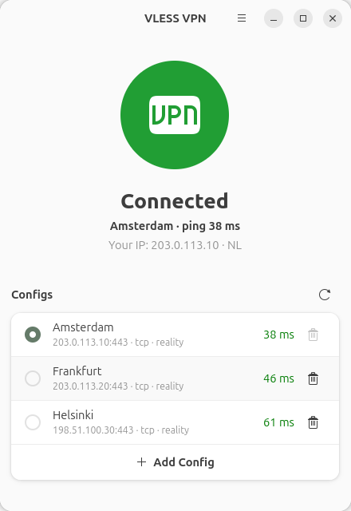
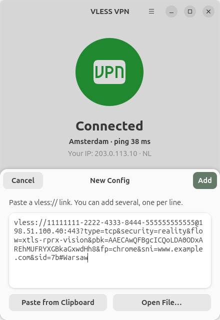

# VLESS VPN

A simple VPN client for Linux. It connects your computer to your own VLESS server: paste a vless:// link, press the big button, and all traffic of the system goes through the server.

[Русская версия](README.ru.md)



## Features

- One button to connect and disconnect.
- Several servers in one list, each with its ping. Switching takes one click.
- VLESS with Reality and XTLS Vision, TLS, WebSocket, gRPC, HTTP/2 and HTTPUpgrade.
- The whole system goes through the tunnel, not only the browser. The local network and Docker stay direct.
- DNS requests go through the tunnel too, so your internet provider does not see which sites you open.
- After connecting, the app shows the public IP address and country that websites see.
- English and Russian interface. The language follows the system and can be changed in the menu.

## Install

### From the Snap Store

```bash
sudo snap install vless-vpn
sudo snap connect vless-vpn:network-control
sudo snap connect vless-vpn:firewall-control
```

The two `snap connect` commands allow the app to create the tunnel. Snap does not grant these permissions on its own, so they are needed once after installing. If you forget them, the app shows the exact command and a button to copy it.

### With the install script

Use this if you do not want Snap. It works on any Linux with systemd, Python 3.10 or newer, GTK 4 and libadwaita 1.5 or newer: Ubuntu 24.04 and newer, Debian 13, Fedora 40 and newer, Arch. The processor must be x86_64 or ARM64.

Install the libraries first. On Ubuntu and Debian:

```bash
sudo apt install git python3-gi gir1.2-gtk-4.0 gir1.2-adw-1
```

On Fedora: `sudo dnf install git python3-gobject gtk4 libadwaita`. On Arch: `sudo pacman -S git python-gobject gtk4 libadwaita`.

Then install the app:

```bash
git clone https://github.com/AlionaVarec/vless-vpn.git
cd vless-vpn
./install.sh
```

The script asks for your password, downloads the official sing-box 1.14.3 release and checks its SHA-256 sum. Run it again to update. To remove the app, run `./uninstall.sh`. Your list of servers stays in `~/.config/vless-vpn`.

Do not keep the snap and the script version installed at the same time. Both would try to create the same tunnel.

## How to use

1. Open VLESS VPN from the app menu.
2. Press "Add Config" and paste a vless:// link. You can paste several links, one per line, or open a text file with them.
3. Choose a server and press the round button. When it turns green, all traffic goes through the VPN.



Closing the window does not turn the VPN off. To turn it off, open the app and press the button again. After a restart of the computer the VPN is off.

To change the language, open the menu in the top right corner and choose Language.

Links can also be added from a terminal:

```bash
vless-vpn --import links.txt
```

## Supported links

| Parameter | Supported values |
|---|---|
| Transport (`type`) | `tcp` (also called `raw`), `ws`, `grpc`, `http`, `h2`, `httpupgrade` |
| Security (`security`) | `none`, `tls`, `reality` |
| Flow (`flow`) | `xtls-rprx-vision` |

The sing-box core does not support `xhttp`, `kcp` and `quic` transports, VLESS `encryption` and TCP with `headerType=http`. The app refuses such links and says why.

### Server settings

sing-box introduces itself to the server as an Xray 1.8.1 client. Xray 26 refuses clients older than 26.3.27 by default. If your server runs Xray 26, set `minClientVer` in the Reality settings of the inbound to `1.8.0` or lower, otherwise this app cannot connect.

## How it works

- Your links are stored in `~/.config/vless-vpn`, or in `~/snap/vless-vpn/current/.config/vless-vpn` for the snap. Only your user can read these files.
- A small service runs as root and starts the sing-box core when you press the button. The window sends it only the link and the addresses of the servers. The service checks them and writes the sing-box config itself, so it never runs a config that came from outside.
- Only root and members of the `sudo`, `admin` or `wheel` groups can control the service. Other accounts on the same computer cannot turn the VPN on or change the server.
- sing-box creates the `vless0` network interface and routes the whole system through it. Local networks (10.0.0.0/8, 172.16.0.0/12, 192.168.0.0/16, link-local) and the VPN servers themselves go around the tunnel, so the ping you see is real even when the VPN is on.
- DNS goes to 1.1.1.1 over HTTPS inside the tunnel. Only IPv4 is used, and IPv6 traffic does not leak around the tunnel.
- The button turns green only when the routes and DNS of the tunnel are ready, so the first requests do not go around the VPN.
- If sing-box stops while connected, the service restarts it after 5 seconds. If it keeps failing within a minute, the service stops trying and the window shows the error.
- Ping is the time of a TCP handshake with the server port, the best of two tries, measured every 30 seconds.
- To show your public IP, the app requests `https://cloudflare.com/cdn-cgi/trace`. The app sends nothing anywhere else and collects no data.

## Known limitations

- A DNS request that a program sends directly to your router (for example to 192.168.1.1) goes around the tunnel, because local networks are excluded from it. The system resolver, browsers and Docker use the DNS of the tunnel.
- Running another VPN at the same time (WireGuard, OpenVPN) has not been tested.

## Development

```bash
git clone https://github.com/AlionaVarec/vless-vpn.git
cd vless-vpn
python3 tools/msgfmt.py        # compile translations
./vless-vpn                    # run the window from the source folder
python3 -m pytest              # run the tests
```

The window needs the service. Install it once with `./install.sh` or start it by hand in a separate terminal:

```bash
sudo ./vless-vpnd --socket /run/vless-vpn/control.sock --work-dir /var/lib/vless-vpn
```

Translations live in `po/`. After changing texts in the code, run `python3 tools/update_po.py` and translate the new lines in `po/ru.po`. A new language needs its own `po/<code>.po` file and its code in `LANGUAGES` in `vless_vpn/i18n.py`.

To build the snap: `snapcraft pack`.

## License

VLESS VPN is free software under the GNU General Public License version 3 or later, see [LICENSE](LICENSE).

The tunnel is made by [sing-box](https://github.com/SagerNet/sing-box) by SagerNet, also licensed under GPL-3.0-or-later. The snap and the install script use the unmodified official sing-box release binary.
