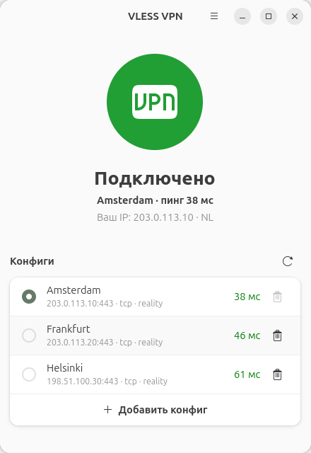
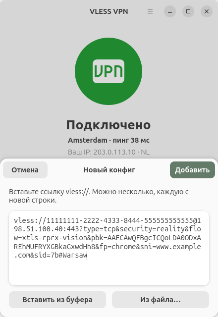

# VLESS VPN

Простой VPN-клиент для Linux. Он подключает компьютер к вашему собственному серверу VLESS: вставьте ссылку vless://, нажмите большую кнопку, и весь трафик системы пойдёт через сервер.

[English version](README.md)



## Возможности

- Одна кнопка, чтобы включить и выключить VPN.
- Несколько серверов в одном списке, у каждого виден пинг. Переключение в один клик.
- VLESS с Reality и XTLS Vision, TLS, WebSocket, gRPC, HTTP/2 и HTTPUpgrade.
- Через туннель идёт вся система, а не только браузер. Локальная сеть и Docker работают напрямую.
- DNS-запросы тоже идут через туннель, поэтому провайдер не видит, какие сайты вы открываете.
- После подключения приложение показывает внешний IP-адрес и страну, которые видят сайты.
- Интерфейс на русском и английском. Язык берётся из системы, его можно сменить в меню.

## Установка

### Из Snap Store

```bash
sudo snap install vless-vpn
sudo snap connect vless-vpn:network-control
sudo snap connect vless-vpn:firewall-control
```

Две команды `snap connect` разрешают приложению создать туннель. Snap не выдаёт эти разрешения сам, поэтому их нужно выполнить один раз после установки. Если забыть, приложение покажет точную команду и кнопку, чтобы её скопировать.

### Скриптом установки

Этот способ для тех, кто не хочет Snap. Подходит любой Linux с systemd, Python 3.10 или новее, GTK 4 и libadwaita 1.5 или новее: Ubuntu 24.04 и новее, Debian 13, Fedora 40 и новее, Arch. Процессор x86_64 или ARM64.

Сначала поставьте библиотеки. В Ubuntu и Debian:

```bash
sudo apt install git python3-gi gir1.2-gtk-4.0 gir1.2-adw-1
```

В Fedora: `sudo dnf install git python3-gobject gtk4 libadwaita`. В Arch: `sudo pacman -S git python-gobject gtk4 libadwaita`.

Потом установите приложение:

```bash
git clone https://github.com/AlionaVarec/vless-vpn.git
cd vless-vpn
./install.sh
```

Скрипт спросит пароль, скачает официальный выпуск sing-box 1.14.3 и сверит его контрольную сумму SHA-256. Для обновления запустите его ещё раз. Удалить приложение: `./uninstall.sh`. Список серверов останется в `~/.config/vless-vpn`.

Не держите одновременно версию из Snap и версию из скрипта. Обе будут пытаться создать один и тот же туннель.

## Как пользоваться

1. Откройте VLESS VPN из меню приложений.
2. Нажмите «Добавить конфиг» и вставьте ссылку vless://. Можно вставить несколько ссылок, каждую с новой строки, или открыть текстовый файл со ссылками.
3. Выберите сервер и нажмите круглую кнопку. Когда она станет зелёной, весь трафик идёт через VPN.



Если закрыть окно, VPN продолжит работать. Чтобы выключить его, откройте приложение и нажмите кнопку ещё раз. После перезагрузки компьютера VPN выключен.

Язык меняется в меню в правом верхнем углу, пункт «Язык».

Ссылки можно добавить и из терминала:

```bash
vless-vpn --import links.txt
```

## Какие ссылки поддерживаются

| Параметр | Поддерживается |
|---|---|
| Транспорт (`type`) | `tcp` (он же `raw`), `ws`, `grpc`, `http`, `h2`, `httpupgrade` |
| Защита (`security`) | `none`, `tls`, `reality` |
| Поток (`flow`) | `xtls-rprx-vision` |

Ядро sing-box не поддерживает транспорты `xhttp`, `kcp` и `quic`, шифрование VLESS (`encryption`) и TCP с `headerType=http`. Такие ссылки приложение не примет и объяснит почему.

### Настройка сервера

sing-box представляется серверу клиентом Xray 1.8.1. Xray 26 по умолчанию не пускает клиентов с версией ниже 26.3.27. Если на сервере Xray 26, укажите в настройках Reality входящего подключения `minClientVer` равным `1.8.0` или ниже, иначе приложение не подключится.

## Как это устроено

- Ссылки хранятся в `~/.config/vless-vpn`, а у версии из Snap в `~/snap/vless-vpn/current/.config/vless-vpn`. Читать эти файлы может только ваш пользователь.
- Небольшая служба работает с правами root и запускает ядро sing-box, когда вы нажимаете кнопку. Окно передаёт ей только ссылку и адреса серверов. Служба проверяет их и сама пишет конфиг sing-box, поэтому конфиг, пришедший извне, она никогда не запускает.
- Управлять службой могут только root и участники групп `sudo`, `admin` или `wheel`. Другие учётные записи на том же компьютере не могут включить VPN или сменить сервер.
- sing-box создаёт сетевой интерфейс `vless0` и направляет через него всю систему. Локальные сети (10.0.0.0/8, 172.16.0.0/12, 192.168.0.0/16, link-local) и сами серверы VPN идут мимо туннеля, поэтому пинг честный и при включённом VPN.
- DNS идёт на 1.1.1.1 по HTTPS внутри туннеля. Используется только IPv4, трафик IPv6 мимо туннеля не уходит.
- Кнопка становится зелёной только тогда, когда маршруты и DNS туннеля готовы, поэтому первые запросы не проходят мимо VPN.
- Если sing-box остановился во время работы, служба перезапускает его через 5 секунд. Если ядро падает снова и снова в течение минуты, служба прекращает попытки, а окно показывает ошибку.
- Пинг измеряется как время TCP-рукопожатия с портом сервера, берётся лучшая из двух попыток, замер раз в 30 секунд.
- Чтобы показать внешний IP, приложение обращается к `https://cloudflare.com/cdn-cgi/trace`. Больше оно никуда ничего не отправляет и данные не собирает.

## Известные ограничения

- DNS-запрос, который программа отправляет прямо на роутер (например, на 192.168.1.1), идёт мимо туннеля, потому что локальные сети из него исключены. Системный резолвер, браузеры и Docker пользуются DNS туннеля.
- Работа вместе с другим VPN (WireGuard, OpenVPN) не проверялась.

## Разработка

```bash
git clone https://github.com/AlionaVarec/vless-vpn.git
cd vless-vpn
python3 tools/msgfmt.py        # собрать переводы
./vless-vpn                    # запустить окно из папки с кодом
python3 -m pytest              # тесты
```

Окну нужна служба. Поставьте её один раз через `./install.sh` или запустите вручную в отдельном терминале:

```bash
sudo ./vless-vpnd --socket /run/vless-vpn/control.sock --work-dir /var/lib/vless-vpn
```

Переводы лежат в `po/`. После изменения текстов в коде запустите `python3 tools/update_po.py` и переведите новые строки в `po/ru.po`. Для нового языка нужен свой файл `po/<код>.po` и код языка в `LANGUAGES` в `vless_vpn/i18n.py`.

Собрать snap: `snapcraft pack`.

## Лицензия

VLESS VPN распространяется свободно по лицензии GNU General Public License версии 3 или новее, текст в файле [LICENSE](LICENSE).

Туннель строит [sing-box](https://github.com/SagerNet/sing-box) от SagerNet, он тоже под лицензией GPL-3.0-or-later. Snap и скрипт установки используют официальный выпуск sing-box без изменений.
